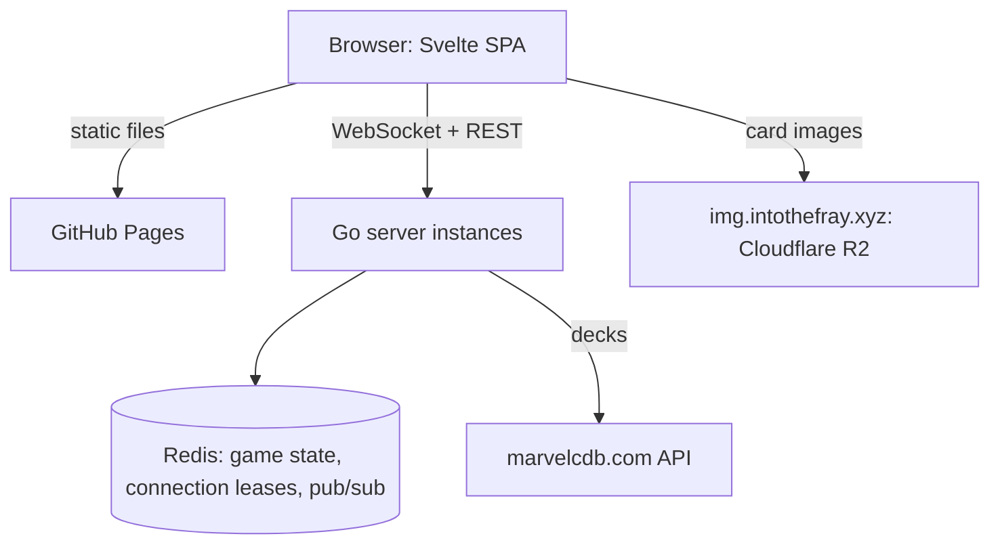

# Development

How to build, run, test and deploy Into The Fray. For what the app does,
see the [README](README.md).

## Prerequisites

- Go 1.27 or later
- Docker (or Podman) with Compose, to run Redis and Caddy locally
- [Air](https://github.com/air-verse/air) for hot reload
- [golangci-lint](https://golangci-lint.run/) v2 for static checks
- Node.js and [pnpm](https://pnpm.io/) at the versions pinned in
  `mise.toml` (`mise install` with [mise](https://mise.jdx.dev/))

## Local stack

```bash
make dev
```

`make dev` starts Redis and Caddy in containers, installs the web
dependencies, then runs the Go server under Air and the web build in
watch mode. Open <http://localhost:8080>: Caddy serves `web/dist` and
proxies `/api/*` and `/ws/*` to the server on port 9000. The server
reloads on save; the web app is rebuilt on save, without hot module
replacement, so reload the page.

`make app-up` runs the same stack fully in containers, on the same ports:
stop one before starting the other. Redis and the server are published on
`127.0.0.1` only; the web port listens on every interface, so a phone on
the local network can open the app. With Podman, pass
`COMPOSE="podman compose"` to `make` unless its `docker` command is set
up.

## Make targets

Run `make` to list them all. The common ones:

```bash
make dev          # Redis + Caddy in containers, Air, web build
make test         # Go tests with the race detector
make check        # tests, web-check, then golangci-lint
make web-install  # install the web dependencies (needed by check)
make web-check    # svelte-check, ESLint + Prettier, Vitest
make web-build    # production build into web/dist/
make build        # bin/intothefray
make sources      # card image sources, packs/images/sources.json
make packs        # card packs in packs/dist/
make infra-down   # stop Redis and Caddy
make app-up       # build the web app, then run the whole stack
make app-down     # stop and remove the containerised stack
```

`pnpm bench` in `web/` times the table redraw after a server update
(`BENCH_CARDS` sets the card count, 120 by default).

## Configuration

| Variable          | Description                | Default                    |
| ----------------- | -------------------------- | -------------------------- |
| `PORT`            | Server HTTP port           | `9000`                     |
| `REDIS_URL`       | Redis connection           | `redis://localhost:6379/0` |
| `ALLOWED_ORIGINS` | Cross-origin frontends     | empty                      |
| `GAME_TTL`        | Idle game expiry           | `24h`                      |
| `MARVELCDB_URL`   | Deck source                | `https://marvelcdb.com`    |
| `WEB_PORT`        | Local web port (Caddy)     | `8080`                     |
| `REDIS_PORT`      | Local Redis host port      | `6379`                     |
| `VITE_API_URL`    | API origin, web build only | same origin                |
| `APP_INSTANCE`    | Tab title suffix, web only | empty                      |

`ALLOWED_ORIGINS` is a comma-separated list of `scheme://host[:port]`
origins; same-origin requests always pass. Set variables in `.env`, or in
`.env.local` for the development targets only.

## Casper workspaces

[Casper](https://github.com/alexandreroman/casper) support is optional
and lives in `.casper.json` and `scripts/casper.sh`. In a workspace, the
setup hook writes `.env.casper` with the ports (web `CASPER_PORT`, server
+1, Redis +2) and the branch as `APP_INSTANCE`; `casper run` starts
`make dev` on those ports. Values in `.env` or `.env.local` win.

## Card packs

`make packs` fetches the card data (marvelcdb, completed by mc4db, and
Cerebro) and the French names (mc4db, fr.marvelcdb, cgbuilder), caches
them in `packs/.cache`, merges the hand-written files of
`packs/curated/`, and writes `packs/dist/`. Commit the regenerated files
with the change that caused them; never edit `packs/dist/` by hand.

Card images are served from `https://img.intothefray.xyz`, filled by the
private `intothefray-img` repository. To add images:

1. `make sources`, then commit `packs/images/sources.json`;
2. `make publish` in `intothefray-img`, which writes
   `packs/images/manifest.json` here;
3. `make packs`, then commit the manifest and `packs/dist/`.

`make packs` fails without the manifest and drops a card that has a face
without an English image. Its report lists the French coverage and the
records taken from mc4db. The merging rules are documented in
`internal/packgen/`; the curated formats in `internal/packgen/curated/`.

## Continuous integration

`.github/workflows/ci.yml` runs on pull requests and pushes to `main`,
with three jobs: `go` (build, race tests, golangci-lint), `web`
(svelte-check, ESLint, Prettier, Vitest, build) and `docker` (image
build, `compose.yaml` and Caddyfile validation). It does not regenerate
`packs/dist/`.

## Deployment

On `main` (a push, or a manual run of `ci.yml` to republish), once the
checks pass:

1. `publish` pushes `ghcr.io/alexandreroman/intothefray`, tagged with the
   commit SHA and `main`;
2. `pages` deploys the web app to GitHub Pages at
   `https://intothefray.xyz`;
3. `deploy-backend` asks the private `intothefray-infra` repository to
   deploy that image on the VPS at `https://api.intothefray.xyz`.

Repository settings: Pages source set to GitHub Actions with the custom
domain `intothefray.xyz`; the `API_URL` variable
(`https://api.intothefray.xyz`, required by the Pages build); the
`INFRA_DISPATCH_TOKEN` secret, a fine-grained token with Contents read
and write on `intothefray-infra` only (without it, the backend deployment
is skipped with a warning). The GHCR package is public. The backend runs
with `ALLOWED_ORIGINS=https://intothefray.xyz`.

`GET /api/version` and the Options screen report the commit of the
server and of the app, so a mismatch between the two shows at once.

## Architecture



The Go instances are stateless and share game state through Redis. The
server embeds every card pack; the web app ships only the pack index and
loads a game's cards from `GET /api/games/{id}/cards`. The module map is
in [CLAUDE.md](CLAUDE.md#modules).
