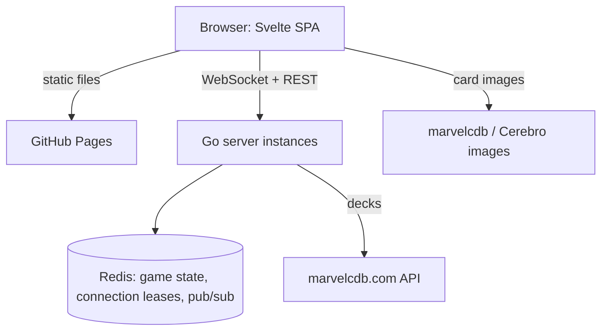

# intothefray

Into The Fray is an online card table for Marvel Champions: The
Card Game. Open a link, load your decks, and play in the browser,
solo or with friends, up to four decks at the table. It is a pure
sandbox: cards move the way they would on a real table, and the app
never applies the game's rules.

## Features

Everything below works today, except where noted.

- **Play in the browser** — no install, desktop or touch screen
- **Invite by link** — friends join as players while the game has
  not started and fewer than four decks are seated, otherwise as
  spectators
- **No account** — a free pseudonym, stored in your browser only
- **Bring your decks** — load a deck from a marvelcdb.com URL. In
  the lobby, **Add a deck** lets a player control 1 to 4 decks, with
  four decks in all at the table and any split between players; each
  deck has its own deck link and its own Ready
- **Several hands** — at the table each deck has its own row. With
  several decks, the player selector at the bottom left or the `Q`
  key picks the hand shown. An action is credited to the deck of the
  card or pile you touch, else to the selected deck
- **Automated setup** — pick a scenario, a difficulty and the
  modular sets: villain, main scheme and decks are laid out for you
- **Discoverable actions** — every action one or two clicks away,
  and you always see what the other players just did: history,
  live cursors, pings, arrows and animated moves
- **Undo** — take back your own last actions, across all your decks
- **Keyboard shortcuts** — press `?` at the table for the full sheet
- **Themes** — official, minimal or green felt, per viewer
- **Fair play** — each player receives only what they may see
  (no peeking at hands, deck order or face-down cards)
- **The whole card range** — expansions are added as data files,
  card images load from their public sources. *Partly there:* the
  player cards of every pack are in, the scenarios of the Core Set
  (Rhino, Klaw, Ultron) only so far

## Prerequisites

- Go 1.27 or later
- Docker (or Podman) with Compose, to run Redis and Caddy locally
- [Air](https://github.com/air-verse/air) for hot reload
- [golangci-lint](https://golangci-lint.run/) v2 for static checks
- Node.js 24 and [pnpm](https://pnpm.io/) for the frontend, or
  [mise](https://mise.jdx.dev/) to install both at the pinned versions
  (`mise install`, see `mise.toml`)

## Getting Started

Clone the repository, install the frontend dependencies, and start
the stack with hot reload. Redis and Caddy (the web server) start in
containers first.

```bash
git clone https://github.com/alexandreroman/intothefray.git
cd intothefray
make web-install
make dev
```

Open the app at <http://localhost:8080>: Caddy serves the frontend
and proxies `/api/*` and `/ws/*` to the Go server, so this is the
single entry point. Check that the server answers:

```bash
curl http://localhost:9000/healthz
```

The Go server reloads under Air when you save. The frontend is
rebuilt on save (`vite build --watch`), without hot module
replacement: reload the page to see your change.

## Usage

Run `make` to list every available target. The most common ones:

```bash
make dev        # start Redis and Caddy, then the server and the web build
make test       # run the test suite (race detector on)
make check      # run the tests, the web checks, then golangci-lint
make web-check  # type-check, lint and test the web app
make web-build  # build the web app into web/dist
make build      # build bin/intothefray
make packs      # regenerate the card packs in packs/dist
make infra-down # stop Redis and Caddy
make app-up     # build the web app, then start Caddy, server and Redis
make app-logs   # follow the logs of the containerised stack
make app-down   # stop and remove the containerised stack
```

`make dev` and `make check` need the frontend dependencies: run
`make web-install` once on a fresh clone first.

`make dev` runs Redis and Caddy in containers, so it needs a running
container engine: Docker, or Podman with its Docker-compatible
`docker` command (or pass `COMPOSE="podman compose"` to `make`).

`make app-up` builds the frontend on the host (`make web-build`),
then starts Caddy, which serves `web/dist` and proxies to the server
container. The web app is available at <http://localhost:8080>.
Caddy also answers `/healthz` on that port, for the container
healthcheck.

The web app routes on real paths: `/` (home), `/options` and
`/g/<id>` (a game). Caddy serves `index.html` for any path that is
not a file, so a game link opens directly. The API, the health probe
and everything under `/assets/` and `/packs/` are left out: a missing
asset or pack answers 404.

`make dev` and `make app-up` both bind ports 9000 and 8080: stop one
before starting the other.

### Casper workspaces

Support for [Casper](https://github.com/alexandreroman/casper) is
optional: without it nothing changes, and `make dev`, `make app-up` and
the other targets work as described above. The Makefile never reads
Casper files.

In a Casper worktree workspace, the setup hook of `.casper.json`
(`scripts/casper.sh setup`) writes an untracked `.env.casper` from
`CASPER_PORT`:

| Service | Port              |
| ------- | ----------------- |
| Web     | `CASPER_PORT`     |
| Server  | `CASPER_PORT + 1` |
| Redis   | `CASPER_PORT + 2` |

Two commands start the stack, both with the ports of `.env.casper` and
both listing the workspace URLs in the Casper info panel:

- **Run** (`casper run`, that is `scripts/casper.sh run`) starts the
  whole stack in containers with `make app-up` (Caddy, server and
  Redis) and follows its logs. Stopping the command runs
  `make app-down`.
- **Dev** (`casper run dev`) starts `make dev` with hot reload (Redis,
  Caddy, Air and the web build). Stopping the command stops Air and the
  web build only: the Redis and Caddy containers stay up (stop them
  with `make infra-down`).

Run stops its stack and both clear the panel when the command ends.
They bind the same server port, so run one at a time. Several workspaces can
run at the same time, each with its own compose project. A `PORT` set in
`.env` or `.env.local` overrides `.env.casper`.

`.env.casper` holds only the ports. In a worktree whose `.env.casper`
still sets `VITE_API_URL` or `ALLOWED_ORIGINS`, re-run
`scripts/casper.sh setup`: a stale file breaks the container flow
(`casper run`) and makes the dev flow bypass Caddy.

`make packs` downloads the card data from marvelcdb and Cerebro
(cached in `packs/.cache`), merges the hand-written files of
`packs/curated/`, and writes the result to `packs/dist/`. Commit the
regenerated files with the change that caused them. The curated files are
the scenarios (`scenarios/`), card overrides (`cards.json`) and set data
(`sets.json`: the cards a set starts in play at each difficulty, and the
sets the lobby leaves out).

## Configuration

| Variable          | Description      | Default                    |
| ----------------- | ---------------- | -------------------------- |
| `PORT`            | HTTP listen port | `9000`                     |
| `REDIS_URL`       | Redis connection | `redis://localhost:6379/0` |
| `ALLOWED_ORIGINS` | Allowed origins  | empty                      |
| `GAME_TTL`        | Idle game expiry | `24h`                      |
| `MARVELCDB_URL`   | Deck source      | `https://marvelcdb.com`    |

`ALLOWED_ORIGINS` is a comma-separated list of origins, each written
`scheme://host[:port]` (http or https, no path): the server refuses
to start otherwise. Same-origin requests always pass, so it is only
needed when the frontend is served from another origin, such as
GitHub Pages.

The frontend calls the API with same-origin URLs. `VITE_API_URL` is
only needed at build time for a cross-origin deployment (see
Deployment).

`make` loads `.env` when it exists, and `.env.local` for the
development targets.

The web port is read from `WEB_PORT` (default `8080`) and the Redis
host port of the compose stack from `REDIS_PORT` (default `6379`).

## Continuous integration

The `CI` workflow runs on every pull request and every push to `main`,
in three jobs:

- `go`: build, `go vet`, tests with the race detector, golangci-lint;
- `web`: svelte-check, ESLint and Prettier, Vitest, production build;
- `docker`: image build (not pushed), validation of `compose.yaml` and
  of the Caddyfile.

It runs the same checks as `make check` and `make build`. It does not
regenerate `packs/dist`: the generator needs marvelcdb and Cerebro
over the network, so the committed files are used as they are.

## Deployment

The frontend is published to GitHub Pages by the `Pages` workflow
on every push to `main`. In the repository settings:

- set the Pages source to GitHub Actions;
- set the `API_URL` variable to the public URL of the backend (the
  workflow passes it to the build as `VITE_API_URL`).

The backend must accept the Pages origin: add it to
`ALLOWED_ORIGINS`, written `scheme://host` with no path, for example
`https://alexandreroman.github.io`.

The backend sends its responses uncompressed: put it behind a proxy
or CDN that compresses them (Cloudflare or equivalent), as Caddy does
locally.

The workflow builds the app under the site's base path, as reported
by `actions/configure-pages`: `/<repo>/` for a project site, `/` at
the domain root (custom domain or user/organisation site). Pages has
no rewrite rules, so the workflow copies `index.html` to `404.html`:
a deep link such as `/<repo>/g/<id>` gets the app, which then reads
the path.

## Architecture

A static frontend served on its own (GitHub Pages) talks to
stateless Go instances that share game state through Redis.



The server embeds every card pack. The frontend publishes only the
pack index (`packs/<lang>/index.json`), which the lobby reads to
pick a scenario. Once the table is set up, the client downloads the
game's card pool from `GET /api/games/{id}/cards`: the definitions
of the cards in that game only, cached by the browser (`ETag`,
immutable). The table then asks the browser to download the images
of those cards at low priority, so no card shows empty the first
time it appears (not when the browser asks to save data).

| Path                | Description                                    |
| ------------------- | ---------------------------------------------- |
| `cmd/intothefray/`  | Server entry point (HTTP, health check)        |
| `cmd/packgen/`      | Card pack generator (`make packs`)             |
| `internal/config/`  | Configuration from environment variables       |
| `internal/decks/`   | Deck import from marvelcdb                     |
| `internal/game/`    | Game engine: lobby, setup, actions, undo, view |
| `internal/server/`  | HTTP API, WebSocket endpoint, instance fan-out |
| `internal/store/`   | Redis game store, connection leases, pub/sub   |
| `internal/pack/`    | Card pack schema and catalog                   |
| `internal/packgen/` | Generator internals (fetch, build, images...)  |
| `packs/`            | Curated files, generated and committed `dist/` |
| `web/`              | Svelte frontend (Vite, pnpm, Caddyfile)        |
| `mise.toml`         | Node.js and pnpm versions                      |
| `.github/`          | GitHub Actions (CI, Pages deployment)          |

## License

This project is licensed under the Apache-2.0 License — see
[LICENSE](LICENSE) for details.
