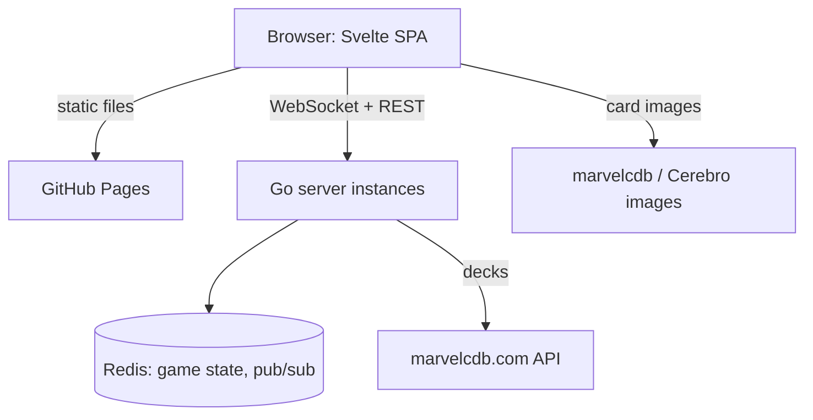

# intothefray

Into The Fray is an online card table for Marvel Champions: The
Card Game. Open a link, load your deck, and play in the browser,
solo or with up to three friends. It is a pure sandbox: cards move
the way they would on a real table, and the app never applies the
game's rules.

> **Work in progress.** The backend runs: the game API, the
> WebSocket endpoint and the Redis store. The browser frontend comes
> next, so the features below are the target, not what you can play
> today.

## Features

- **Play in the browser** — no install, desktop or touch screen
- **Invite by link** — friends join as players until the game
  starts, then as spectators
- **No account** — a free pseudonym, stored in your browser only
- **Bring your deck** — load a deck from a marvelcdb.com URL
- **Discoverable actions** — every action one or two clicks away,
  and you always see what the other players just did
- **Fair play** — each player receives only what they may see
  (no peeking at hands, deck order or face-down cards)
- **The whole card range** — expansions are added as data files,
  card images load from their public sources

## Prerequisites

- Go 1.27 or later
- Docker (or Podman) with Compose, to run Redis locally
- [Air](https://github.com/air-verse/air) for hot reload
- [golangci-lint](https://golangci-lint.run/) v2 for static checks
- Node.js 24 and [pnpm](https://pnpm.io/) for the frontend

## Getting Started

Clone the repository, install the frontend dependencies, and start
the stack with hot reload. Redis starts in a container first.

```bash
git clone https://github.com/alexandreroman/intothefray.git
cd intothefray
make web-install
make dev
```

Open the frontend at <http://localhost:5173>. Check that the server
answers:

```bash
curl http://localhost:8080/healthz
```

## Usage

Run `make` to list every available target. The most common ones:

```bash
make dev        # start Redis, then the server with hot reload
make test       # run the test suite (race detector on)
make check      # run the tests, then golangci-lint
make build      # build bin/intothefray
make packs      # regenerate the card packs in packs/dist
make infra-down # stop Redis
make app-up     # build the image, start the app and Redis in containers
make app-logs   # follow the logs of the containerised stack
make app-down   # stop and remove the containerised stack
```

`make check` also runs the frontend checks: run `make web-install`
once on a fresh clone first.

`make dev` and `make app-up` both bind port 8080: stop one before
starting the other.

`make packs` downloads the card data from marvelcdb and Cerebro
(cached in `packs/.cache`), merges the hand-written files of
`packs/curated/`, and writes the result to `packs/dist/`. Commit the
regenerated files with the change that caused them.

## Configuration

| Variable          | Description                                    | Default                    |
| ----------------- | ---------------------------------------------- | -------------------------- |
| `PORT`            | HTTP server listen port                        | `8080`                     |
| `REDIS_URL`       | Redis connection                               | `redis://localhost:6379/0` |
| `ALLOWED_ORIGINS` | Frontend origins allowed by CORS and WebSocket | `http://localhost:5173`    |
| `GAME_TTL`        | Expiry of a game nobody touches                | `24h`                      |
| `MARVELCDB_URL`   | Deck source                                    | `https://marvelcdb.com`    |

`ALLOWED_ORIGINS` is a comma-separated list of origins, each written
`scheme://host[:port]` (http or https, no path): the server refuses
to start otherwise.

`make` loads `.env` when it exists, and `.env.local` for the
development targets.

## Deployment

The frontend is published to GitHub Pages by the `Pages` workflow
on every push to `main`. In the repository settings:

- set the Pages source to GitHub Actions;
- set the `API_URL` variable to the public URL of the backend.

The backend must accept the Pages origin: add it to
`ALLOWED_ORIGINS`, written `scheme://host` with no path, for example
`https://alexandreroman.github.io`.

## Architecture

The target design: a static frontend served on its own (GitHub
Pages), talking to stateless Go instances that share game state
through Redis.



| Path                | Description                                    |
| ------------------- | ---------------------------------------------- |
| `cmd/intothefray/`  | Server entry point (HTTP, health check)        |
| `cmd/packgen/`      | Card pack generator (`make packs`)             |
| `internal/config/`  | Configuration from environment variables       |
| `internal/decks/`   | Deck import from marvelcdb                     |
| `internal/game/`    | Game engine: lobby, setup, actions, undo, view |
| `internal/server/`  | HTTP API, WebSocket endpoint, instance fan-out |
| `internal/store/`   | Redis game store and event pub/sub             |
| `internal/pack/`    | Card pack schema and catalog                   |
| `internal/packgen/` | Generator internals (fetch, build, images...)  |
| `packs/`            | Curated files, generated and committed `dist/` |

## License

This project is licensed under the Apache-2.0 License — see
[LICENSE](LICENSE) for details.
