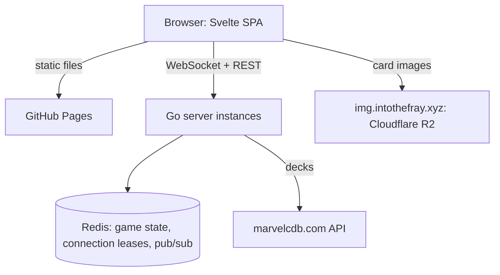

# intothefray

Into The Fray is an online card table for Marvel Champions: The
Card Game. Open a link, load your decks, and play in the browser,
solo or with friends, up to four decks at the table. It is a pure
sandbox: cards move the way they would on a real table, and the app
never applies the game's rules.

## Features

Everything below works today, except where noted.

- **Play in the browser** — no install, desktop or touch screen
- **Invite by link** — friends join as players while the game has
  not started and fewer than four decks are seated, otherwise as
  spectators
- **No account** — a free pseudonym, stored in your browser only
- **Bring your decks** — load a deck from a marvelcdb.com URL. In
  the lobby, **Add a deck** lets a player control 1 to 4 decks, with
  four decks in all at the table and any split between players; each
  deck has its own deck link and its own Ready
- **Several hands** — at the table each deck has its own row. With
  several decks, the player selector at the bottom left or the `Q`
  key picks the hand shown. An action is credited to the deck of the
  card or pile you touch, else to the selected deck
- **Automated setup** — pick a scenario, a difficulty and the modular sets
  (with a Fear No Evil Underling, the main scheme set too):
  villain, main scheme and decks are laid out for you, with each hero's side
  decks (Doctor Strange's Invocation deck and its discard pile, Daredevil's
  Sense deck...) shuffled beside the identity, and the cards a hero or a deck
  card sets aside (Valkyrie's Death-Glow, Iceman's Frostbite, the Specialists of
  Specialized Training...) on its set-aside pile. A scenario can bring its own
  decks and several villains: The Wrecking Crew lays out its four villains, each
  with its own encounter deck, discard pile and side scheme, and the active
  counter, which players move by hand like the first player token. The main
  scheme starts on its stage 1A: players resolve its Setup text themselves. They
  also place the counters: the main scheme's starting threat when they advance
  it to 1B (1A prints none), and counters such as Criminal Enterprise's infamy.
  Only the environments the scenario puts into play as it starts (Criminal
  Enterprise, Ultron Drones, Public Support) and the side schemes its printed
  setup puts in play are placed for you; other cards the Setup text names, such
  as Klaw's Defense Network, stay in the encounter deck
- **Discoverable actions** — every action one or two clicks away,
  and you always see what the other players just did: history,
  live cursors, pings, arrows, and every card that changes place
  travelling there (as a back when you may not see it)
- **Group moves** — drag on an empty spot of the table to select
  the cards you touch, then drag one of them to move them all
  together: elsewhere on the table, onto a pile or a deck, or into
  your hand when they are all yours; Discard and Move to in a
  selected card's menu send the whole selection too. `Esc` lets go
  of the selection
- **Undo** — take back your own last actions, across all your decks
- **Keyboard shortcuts** — press `?` at the table for the full sheet
- **Themes** — official, minimal or green felt, per viewer
- **French cards** — Options offers French: the cards show their French
  names and French scans, served from `img.intothefray.xyz`, and fall back
  to English where a card has no French scan
- **Fair play** — each player receives only what they may see
  (no peeking at hands, deck order or face-down cards)
- **The whole card range** — expansions are added as data files, card images
  load from `img.intothefray.xyz`. *Partly there:* the player cards of every
  pack are in, a few scenarios only so far (Rhino, Klaw, Ultron, Kingpin, Risky
  Business, Mutagen Formula, Wrecking Crew, and Fear No Evil's five Underlings,
  Bullseye, Electro, Hammerhead, Purple Man and Typhoid Mary, each with any of
  its five main scheme sets)

## Prerequisites

- Go 1.27 or later
- Docker (or Podman) with Compose, to run Redis and Caddy locally
- [Air](https://github.com/air-verse/air) for hot reload
- [golangci-lint](https://golangci-lint.run/) v2 for static checks
- Node.js 24 and [pnpm](https://pnpm.io/) for the frontend, or
  [mise](https://mise.jdx.dev/) to install both at the pinned versions
  (`mise install`, see `mise.toml`)

## Getting Started

Clone the repository and start the stack with hot reload: it starts
Redis and Caddy (the web server) in containers, installs the frontend
dependencies, then runs the server and the web build.

```bash
git clone https://github.com/alexandreroman/intothefray.git
cd intothefray
make dev
```

Open the app at <http://localhost:8080>: Caddy serves the frontend
and proxies `/api/*` and `/ws/*` to the Go server, so this is the
single entry point. Check that the server answers:

```bash
curl http://localhost:9000/healthz
```

The Go server reloads under Air when you save. The frontend is
rebuilt on save (`vite build --watch`), without hot module
replacement: reload the page to see your change.

## Usage

Run `make` to list every available target. The most common ones:

```bash
make dev        # start Redis and Caddy, then the server and the web build
make test       # run the Go tests (race detector on)
make check      # run the tests, the web checks, then golangci-lint
make web-check  # type-check, lint and test the web app
make web-build  # build the web app into web/dist
make build      # build bin/intothefray
make packs      # regenerate the card packs in packs/dist
make sources    # write the card image sources, packs/images/sources.json
make infra-down # stop Redis and Caddy
make app-up     # build the web app, then start Caddy, server and Redis
make app-logs   # follow the logs of the containerised stack
make app-down   # stop and remove the containerised stack
```

`make check` needs the frontend dependencies: run `make web-install`
once on a fresh clone (`make dev` and `make web-build` install them).

`make dev` runs Redis and Caddy in containers, so it needs a running
container engine: Docker, or Podman with its Docker-compatible
`docker` command (or pass `COMPOSE="podman compose"` to `make`).

`make app-up` builds the frontend on the host (`make web-build`),
then starts Caddy, which serves `web/dist` and proxies to the server
container. The web app is available at <http://localhost:8080>.
Caddy also answers `/healthz` on that port, for the container
healthcheck.

The web app routes on real paths: `/` (home), `/options` and
`/g/<id>` (a game). Caddy serves `index.html` for any path that is
not a file, so a game link opens directly. The API, the health probe
and everything under `/assets/` and `/packs/` are left out: a missing
asset or pack answers 404.

`make dev` and `make app-up` both bind ports 9000 and 8080: stop one
before starting the other.

### Casper workspaces

Support for [Casper](https://github.com/alexandreroman/casper) is
optional: without it nothing changes, and `make dev`, `make app-up` and
the other targets work as described above. The Makefile never reads
Casper files.

In a Casper worktree workspace, the setup hook of `.casper.json`
(`scripts/casper.sh setup`) writes an untracked `.env.casper` from
`CASPER_PORT`:

| Service | Port              |
| ------- | ----------------- |
| Web     | `CASPER_PORT`     |
| Server  | `CASPER_PORT + 1` |
| Redis   | `CASPER_PORT + 2` |

It also sets `APP_INSTANCE` to the worktree's branch, so the browser
tab of the workspace reads `Into The Fray (<branch>)`.

Two commands start the stack, both with the ports of `.env.casper` and
both listing the workspace URLs in the Casper info panel:

- **Run** (`casper run`, that is `scripts/casper.sh run`) starts the
  whole stack in containers with `make app-up` (Caddy, server and
  Redis) and follows its logs. Stopping the command runs
  `make app-down`.
- **Dev** (`casper run dev`) starts `make dev` with hot reload (Redis,
  Caddy, Air and the web build). Stopping the command stops Air and the
  web build only: the Redis and Caddy containers stay up (stop them
  with `make infra-down`).

Run stops its stack and both clear the panel when the command ends.
They bind the same server port, so run one at a time. Several workspaces can
run at the same time, each with its own compose project. A `PORT` or an
`APP_INSTANCE` set in `.env` overrides `.env.casper`; one set in
`.env.local` does so for Dev only.

`.env.casper` holds the compose project name, the ports, `REDIS_URL` and
the instance name.

### Card packs

`make packs` downloads the card data from marvelcdb, Cerebro and
[mc4db](https://mc4db.merlindumesnil.net), and the French names from
mc4db, fr.marvelcdb.com and [cgbuilder](https://mc.cgbuilder.fr) (all
cached in `packs/.cache`), merges the hand-written files of
`packs/curated/`, takes the card images from the image manifest, and
writes the result to `packs/dist/`. Commit the regenerated files with
the change that caused them.

The card images are served from `https://img.intothefray.xyz`, a
Cloudflare R2 bucket filled by the private `intothefray-img` repository.
Two committed files link the repositories:

- `packs/images/sources.json`, written by `make sources`, lists every
  face the generator builds, with its candidate images (Cerebro image,
  image of the source record, OCTGN image name), before any card is
  dropped;
- `packs/images/manifest.json`, written by `make publish` in
  `intothefray-img`, gives each face its English and French image on the
  CDN. Its URLs are content-addressed, so they never change content.

To add images, run `make sources`, commit `sources.json`, run
`make publish` in `intothefray-img`, then `make packs`. `make packs`
fails when the manifest is missing, and drops a card with a face that has
no English image ("no image" in the report). The report prints how many
faces the manifest covers, per language. Once the manifest exists, a
`packs/` test fails when an embedded image is not under its base URL.

The curated files are the scenarios (`scenarios/`; `mainSchemes` lists the
main scheme sets a scenario such as an Underling's is played with), card
overrides
(`cards.json`: face sizes, the Cerebro image ids of the identities whose
Cerebro images are swapped, and the cards a deck containing a card puts aside
at setup, such as Specialized Training's Specialists, listed on the card's code
rather than a face code) and set data (`sets.json`: the cards a set starts in
play at each difficulty, the sets the lobby leaves out, the main scheme sets
(`mainScheme`, offered among the modular sets), the hero side decks
such as Doctor Strange's Invocation deck, and the cards a hero set puts aside
at setup). A side deck is a `hero_special` set linked to the hero of its pack
whose set code, followed by `_`, starts its own (`doctor_strange` for
`doctor_strange_invocation_deck`); the generator fails when a side deck matches
no hero or several, when a set-aside card is unknown, or when a card's
set-aside cards are listed on a face code or include the card itself. The cards
of a side deck with a shared `back` (Doctor Strange's Invocation deck, Hercules'
Labor and Gift decks, Daredevil's Sense deck, Storm's Weather deck) all get that
back, whatever back the sources give them, and the table captions it with the
deck's label. The hand-written names (`names.json`, by language, then
pack or set code) name the packs and sets no source translates well; the
generator fails when one names a pack or set it does not know.

A face keeps its English name and images, and its `localized` map holds
the overrides of other languages (`localized.fr`: name, subname, images
tried before the English ones). Pack, scenario and set entries of the
index carry a localized name the same way. The generator's report
includes the French coverage.

Each French name comes from the first source that translates it, in this
order: the curated `names.json`, mc4db in French (`?locale=fr`: cards,
packs and sets), fr.marvelcdb, then cgbuilder. Card names come from mc4db
and fr.marvelcdb only. A source counts only where its name differs from
the English one: mc4db and fr.marvelcdb list untranslated content under
its English name, which must not hide a lower source. mc4db packs and
sets map to marvelcdb codes as below; a scenario takes the name of its
villain set.

cgbuilder, a French fan site without API, gives the names of its packs
(`/cycle/`) and modular sets (`/set_modulaire/`), read from its HTML pages
one at a time. Its pack ids are not marvelcdb positions, so the generator
reads each pack's card list (`/liste_carte/{id}/`) and joins it by
content: a cgbuilder pack takes the marvelcdb pack whose French card
names, from the other sources, match those of the same numbers, when they
match at least half its cards and more than any other pack does. A
cgbuilder set takes the marvelcdb set of more than half its cards.

marvelcdb is the primary card source. Where it lists a pack only in part
(such as Fear No Evil, whose encounter cards it lacks), the generator
completes it from mc4db, which shares marvelcdb's schema:

- only official mc4db cards are taken (pack creator `FFG`);
- the rule applies per base code (the five digits without the face
  letter): the mc4db records of a card are added, all of them, only when
  marvelcdb has no record of that base code, so a card's faces never mix
  sources;
- mc4db codes are mapped to marvelcdb ones: a pack goes to the marvelcdb
  pack of the same code, else of the same name
  (`fear_no_evil_by_ffg` is `fne`), else of the same code without
  `_by_ffg` (`thor_by_ffg` is `thor`), and set codes drop `_by_ffg`
  (`daredevil_by_ffg_nemesis` is `daredevil_nemesis`); a pack marvelcdb
  lacks is added under its mc4db code without `_by_ffg`;
- the image sources of an added card are its Cerebro image and its mc4db
  scan.

The report lists the records taken from mc4db, per pack. Cerebro is not
a card-list source: it holds no official card that both marvelcdb and
mc4db lack.

## Configuration

| Variable          | Description      | Default                    |
| ----------------- | ---------------- | -------------------------- |
| `PORT`            | HTTP listen port | `9000`                     |
| `REDIS_URL`       | Redis connection | `redis://localhost:6379/0` |
| `ALLOWED_ORIGINS` | Allowed origins  | empty                      |
| `GAME_TTL`        | Idle game expiry | `24h`                      |
| `MARVELCDB_URL`   | Deck source      | `https://marvelcdb.com`    |

`ALLOWED_ORIGINS` is a comma-separated list of origins, each written
`scheme://host[:port]` (http or https, no path): the server refuses
to start otherwise. Same-origin requests always pass, so it is only
needed when the frontend is served from another origin, such as
GitHub Pages.

The frontend calls the API with same-origin URLs. `VITE_API_URL` is
only needed at build time for a cross-origin deployment (see
Deployment).

`APP_INSTANCE` is an optional instance name, also read at build time
(such as `dev` or a branch name): when set, the browser tab title reads
`Into The Fray (<name>)`, which tells apart the instances of several
versions. Production and GitHub Pages builds leave it unset. Set it in
`.env` or `.env.local`; `.env.local` is only loaded for the development
targets such as `make dev`, so `make web-build` and `make app-up` read it
from `.env`.

The web port is read from `WEB_PORT` (default `8080`) and the Redis
host port of the compose stack from `REDIS_PORT` (default `6379`).

## Continuous integration

The `CI` workflow runs on every pull request and every push to `main`.
Three jobs check every run:

- `go`: build, tests with the race detector, golangci-lint;
- `web`: svelte-check, ESLint and Prettier, Vitest, production build;
- `docker`: image build (not pushed), validation of `compose.yaml` and
  of the Caddyfile.

They run the same checks as `make check`, `make build` and
`make web-build`. They do not
regenerate `packs/dist`: the generator needs marvelcdb, Cerebro and
mc4db over the network, so the committed files are used as they are.

On `main` only, for a push or a manual run (`workflow_dispatch`), the
`web` job also builds the frontend for GitHub Pages in place of its plain
build, and once the three checks have passed, three more jobs run in turn
(see Deployment):

- `publish`: pushes the image to GHCR, tagged with the commit SHA and
  `main`;
- `pages`: deploys the frontend that the `web` job built;
- `deploy-backend`: asks the infra repository to deploy the image.

## Deployment

The frontend is served by GitHub Pages at `https://intothefray.xyz`, the
backend by a VPS behind Cloudflare at `https://api.intothefray.xyz`. A
push to `main` deploys both:

1. the `CI` workflow pushes the image to GHCR as
   `ghcr.io/alexandreroman/intothefray`, tagged with the commit SHA and
   `main`;
2. it publishes to GitHub Pages the frontend that its `web` job built
   from that same commit;
3. it sends a `deploy-app` dispatch to the private
   `alexandreroman/intothefray-infra` repository, which deploys that
   image on the VPS.

The frontend can be live a few minutes before its backend. To republish,
run the `CI` workflow by hand (`workflow_dispatch`) on `main`: it goes
through the same steps.

The site is at the root of its custom domain, so its base path is `/`.
The `web` job still reads the base path from `actions/configure-pages`.
Pages has no rewrite rules, so the job copies `index.html` to
`404.html`: a deep link such as `/g/<id>` gets the app, which then
reads the path.

Both sides report the commit they run, so a mismatch shows at once:

- the backend answers `GET /api/version` with `{"commit": "<sha>"}`, and
  logs the commit when it starts. CI passes the SHA to the image build
  as the `COMMIT` build argument, and labels the published image with
  `org.opencontainers.image.revision`. Without `COMMIT`, a binary built
  from a checkout (`make build`) reports its Git revision, with `-dirty`
  when the checkout has changes, and an image reports `dev`;
- the `web` job of CI passes the SHA to the frontend build for Pages as
  `VITE_COMMIT`. Without it, a build from a checkout (`pnpm build`)
  reports its Git revision, with `-dirty` when the checkout has changes,
  and a build without Git reports `dev`;
- the Options screen shows `version <sha>` (short SHA, plain text) when
  the app and server match, `version mismatch <app>/<server>` when they
  differ (a `dev` build included), and `version <app>/unavailable` when
  the server cannot be reached.

In the repository settings:

- set the Pages source to GitHub Actions, with the custom domain
  `intothefray.xyz`;
- set the `API_URL` variable to `https://api.intothefray.xyz` (the
  workflow passes it to the build as `VITE_API_URL`, and fails if it is
  unset);
- set the `INFRA_DISPATCH_TOKEN` secret to a fine-grained personal
  access token with access to the `intothefray-infra` repository only,
  and the repository permission Contents: read and write (needed by the
  dispatches API). Without it, CI logs a warning and skips the
  backend deployment.

After the first publish, make the `intothefray` package public in its
GHCR package settings (Package settings, Danger Zone, Change
visibility), so that the VPS pulls the image without credentials.

The backend accepts the frontend origin through `ALLOWED_ORIGINS`, set
to `https://intothefray.xyz`. It sends its responses uncompressed:
Cloudflare compresses them, as Caddy does locally. The game WebSocket is
the exception: it negotiates permessage-deflate (without context
takeover), since neither Caddy nor Cloudflare compresses WebSocket frames.

## Architecture

A static frontend served on its own (GitHub Pages) talks to
stateless Go instances that share game state through Redis.



The server embeds every card pack. The frontend publishes only the
pack index (`packs/en/index.json`), which the lobby reads to
pick a scenario. Once the table is set up, the client downloads the
game's card pool from `GET /api/games/{id}/cards`: the definitions
of the cards in that game only, cached by the browser (`ETag`,
immutable). The table then asks the browser to download the images
of those cards at low priority, so no card shows empty the first
time it appears (not when the browser asks to save data).

| Path                | Description                                    |
| ------------------- | ---------------------------------------------- |
| `cmd/intothefray/`  | Server entry point (HTTP, health check)        |
| `cmd/packgen/`      | Card pack generator (`make packs`)             |
| `internal/config/`  | Configuration from environment variables       |
| `internal/decks/`   | Deck import from marvelcdb                     |
| `internal/game/`    | Game engine: lobby, setup, actions, undo, view |
| `internal/server/`  | HTTP API, WebSocket endpoint, instance fan-out |
| `internal/version/` | Commit the binary was built from               |
| `internal/store/`   | Redis game store, connection leases, pub/sub   |
| `internal/pack/`    | Card pack schema and catalog                   |
| `internal/packgen/` | Generator internals (fetch, build, cdn...)     |
| `packs/`            | Curated files, generated and committed `dist/` |
| `web/`              | Svelte frontend (Vite, pnpm, Caddyfile)        |
| `mise.toml`         | Node.js and pnpm versions                      |
| `.github/`          | GitHub Actions (CI, Pages deployment)          |

## License

This project is licensed under the Apache-2.0 License — see
[LICENSE](LICENSE) for details.
