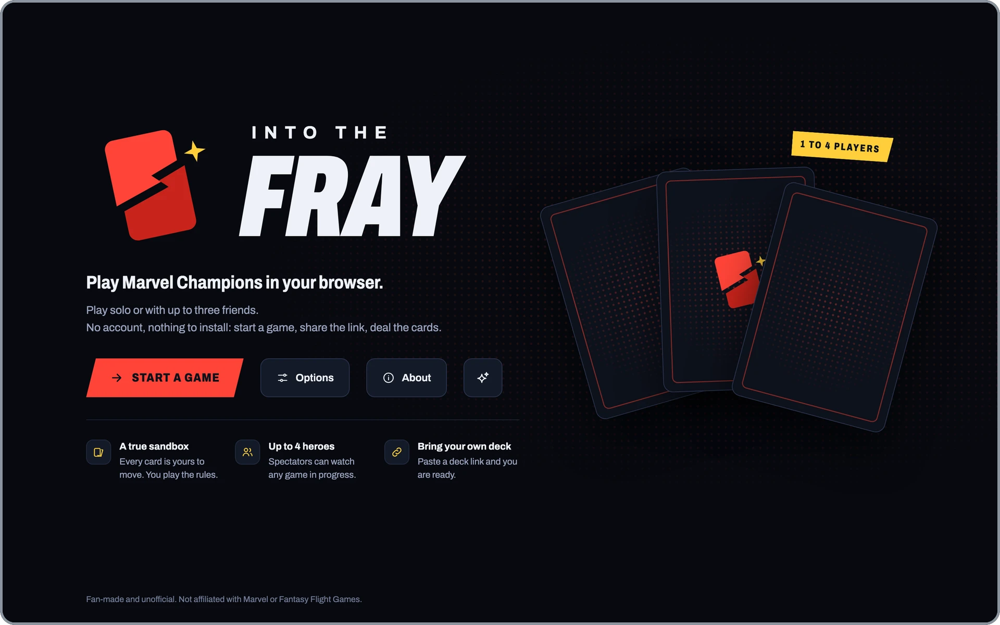

# intothefray

Into The Fray is an online card table for Marvel Champions: The Card Game.
Open a link, load your decks, and play in the browser, solo or with
friends, up to four decks at the table. It is a pure sandbox: cards move
the way they would on a real table, and the app never applies the game's
rules.



## Features

- **Play in the browser**: no install, no account, desktop or touch screen
- **Invite by link**: friends join as players before the game starts,
  then as spectators
- **Bring your decks**: load marvelcdb.com decks, one to four per player
- **Automated setup**: pick a scenario, a difficulty and modular sets;
  villain, schemes, decks and hero side decks are laid out for you, and
  players resolve the rest by hand
- **See what others do**: live cursors, pings, arrows, history, and every
  card that changes place travels there
- **Group moves, undo and keyboard shortcuts** (`?` at the table)
- **Themes and French cards**, chosen per viewer in Options
- **Fair play**: each player receives only what they may see
- **Every pack's player cards**, and a growing list of scenarios

## Quick start

Prerequisites: Go, Docker with Compose, Air, Node.js and pnpm (see
[DEVELOPMENT.md](DEVELOPMENT.md#prerequisites)).

```bash
git clone https://github.com/alexandreroman/intothefray.git
cd intothefray
make dev
```

Open <http://localhost:8080>. Building, testing, configuration, card
packs and deployment are covered in [DEVELOPMENT.md](DEVELOPMENT.md).

## License

This project is licensed under the Apache-2.0 License — see
[LICENSE](LICENSE) for details.
